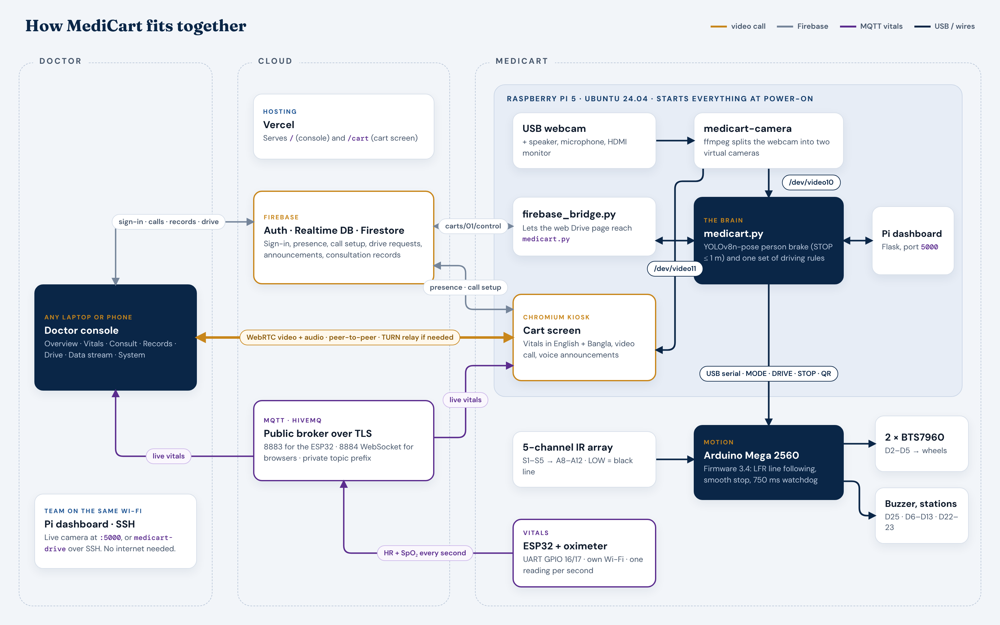
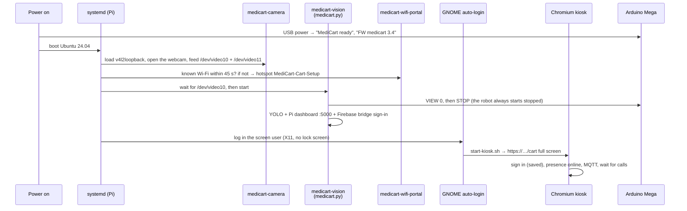
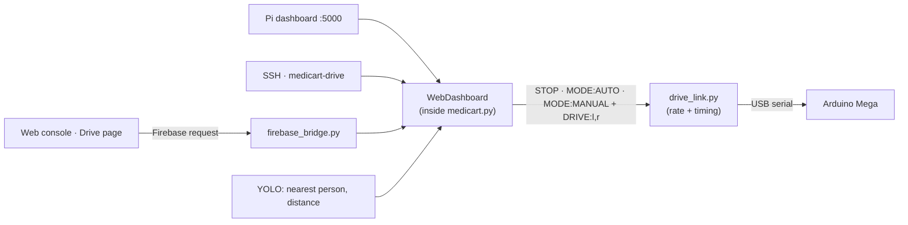

# MediCart architecture

How the five parts of MediCart fit together, what runs where, and why it was built this way.

## The five parts

| Part | Runs on | Code | Job |
|---|---|---|---|
| **Doctor console** | any browser | [`web-src/index.html`](../web-src/index.html) + [`js/console.js`](../web-src/js/console.js) → built into [`index.html`](../index.html) | Sign-in, live vitals, video consultation, records, driving, system health |
| **Cart screen** | Chromium kiosk on the Pi | [`web-src/cart.html`](../web-src/cart.html) + [`js/cart.js`](../web-src/js/cart.js) → [`cart.html`](../cart.html) | Patient-facing screen in English + Bangla, answers calls, plays the voice announcements, logs readings |
| **Robot program** | Raspberry Pi 5 | [`MideCart/vision/medicart.py`](../MideCart/vision/medicart.py) + `web_dashboard.py`, `drive_link.py`, `firebase_bridge.py` | YOLO person brake, station markers, the one set of driving rules, the Pi dashboard, the link to the web Drive page |
| **Motion firmware** | Arduino Mega 2560 | [`arduino/medicart/medicart.ino`](../arduino/medicart/medicart.ino) | Line following (the team's LFR code), manual drive, smooth stop, 750 ms watchdog, buzzer, station outputs |
| **Vital sensor** | ESP32 | [`esp32_sensor/medicart_sensor/medicart_sensor.ino`](../esp32_sensor/medicart_sensor/medicart_sensor.ino) | Reads the UART pulse oximeter, publishes heart rate and SpO₂ over MQTT, Wi-Fi setup portal |

## What happens at power-on

| Service / program | Started by | Logs |
|---|---|---|
| `medicart-camera.service` | systemd | `journalctl -u medicart-camera -f` |
| `medicart-vision.service` → `run-vision.sh` → `medicart.py` | systemd | `journalctl -u medicart-vision -f` |
| `medicart-wifi-portal.service` | systemd | `journalctl -u medicart-wifi-portal -f` |
| `start-kiosk.sh` (Chromium) | desktop autostart after auto-login | `$XDG_RUNTIME_DIR/medicart-kiosk.log` |
| `medicart-status` | you | ✓/✗ for camera split, robot program, Arduino, cart screen, internet + the last robot messages |

## One brain, three remotes

Every way of driving ends up in the same place: `WebDashboard` inside `medicart.py`. It applies Rifat's safety rules every camera frame and sends exactly one command to the Arduino.

| Mode | Arduino receives | What happens |
|---|---|---|
| **Stopped** (start-up, E-stop) | `STOP` | wheels still |
| **Auto** | `MODE:AUTO` while clear, `STOP` for a person | the Arduino follows the line by itself; the camera is the brake |
| **Manual** | `MODE:MANUAL` + `DRIVE:<l>,<r>` every 0.1 s while a key is held, `STOP` for a person | an operator drives (starts at 40, max 180) |

## Data flows

| Data | From → to | Transport |
|---|---|---|
| Heart rate, SpO₂, finger state | ESP32 → console + cart screen | MQTT `<prefix>/01/sensors`, 1 per second |
| Sensor online/offline | ESP32 → console | MQTT `<prefix>/01/status`, retained, last will |
| Video + audio | console ⇄ cart screen | WebRTC (DTLS-SRTP), TURN relay when direct paths are blocked |
| Call setup, prompts | console ⇄ cart screen | Firebase RTDB `calls/<cart>` |
| Presence, heartbeat | cart screen → console | Firebase RTDB `carts/<cart>` |
| Drive requests / robot state | console ⇄ Pi | Firebase RTDB `carts/<cart>/control/*` via `firebase_bridge.py` |
| Announcements | console → cart screen | Firebase RTDB `carts/<cart>/announce` |
| Reading history | cart screen → Firestore | `sensor_history`, every 5 s while a finger is on |
| Consultation records | console → Firestore | `consultations` |

## Design decisions

| Decision | Why |
|---|---|
| **The browser never drives the motors.** It writes a request; the Pi decides. | One set of safety rules, in one place, that a web page can't bypass. There is no remote raw "SAFE". |
| **The Arduino keeps the team's LFR code verbatim** and only adds a protocol around it. | It ran on the robot. A host simulation proves the PWM output matches the original code millisecond by millisecond. |
| **The Arduino stops by itself after 750 ms.** | It covers a crash of the program or the Pi, or a loose cable, without trusting any of them. |
| **One webcam, split in software.** | The cart has room and USB power for one camera, and both YOLO and the call need it at the same time. |
| **The pages are single, self-contained HTML files** (styles, scripts, images and sounds inlined). | Vercel serves them as-is. They load on the kiosk even if one CDN is slow, and an update means uploading 3 files. |
| **Public HiveMQ broker with a long random topic prefix.** | Free, no account to expire, works on campus networks over TLS. For real patient data, move to a private broker. |
| **Passwords live only on the devices** (`/etc/medicart/control.env`, root-only; ESP32 flash). | Nothing secret is committed to the repository or shipped in the web pages, except the public Firebase web config. |
| **Voice announcements play in the browser** (cart screen), not on the Pi. | The cart screen already knows the call state, the vitals and the drive state, so it can keep quiet during a consultation. |

## Where to change things

| To change | Edit | Then |
|---|---|---|
| Firebase project, MQTT broker/prefix, TURN, camera sizes | `web-src/js/config.js` | `python3 tools/build_pages.py`, push |
| Console or cart screen UI | `web-src/**` | build, push |
| Line-following speed, pins | top of `arduino/medicart/medicart.ino` | upload, re-run `tests/run_all.sh` |
| Stop / warning distance, YOLO confidence | top of `MideCart/vision/medicart.py` | `sudo systemctl restart medicart-vision` |
| Cart account, dashboard password, start mode | `/etc/medicart/control.env` on the Pi | restart `medicart-vision` |
| Sensor Wi-Fi / broker | the ESP32 setup page | Save (it restarts) |
