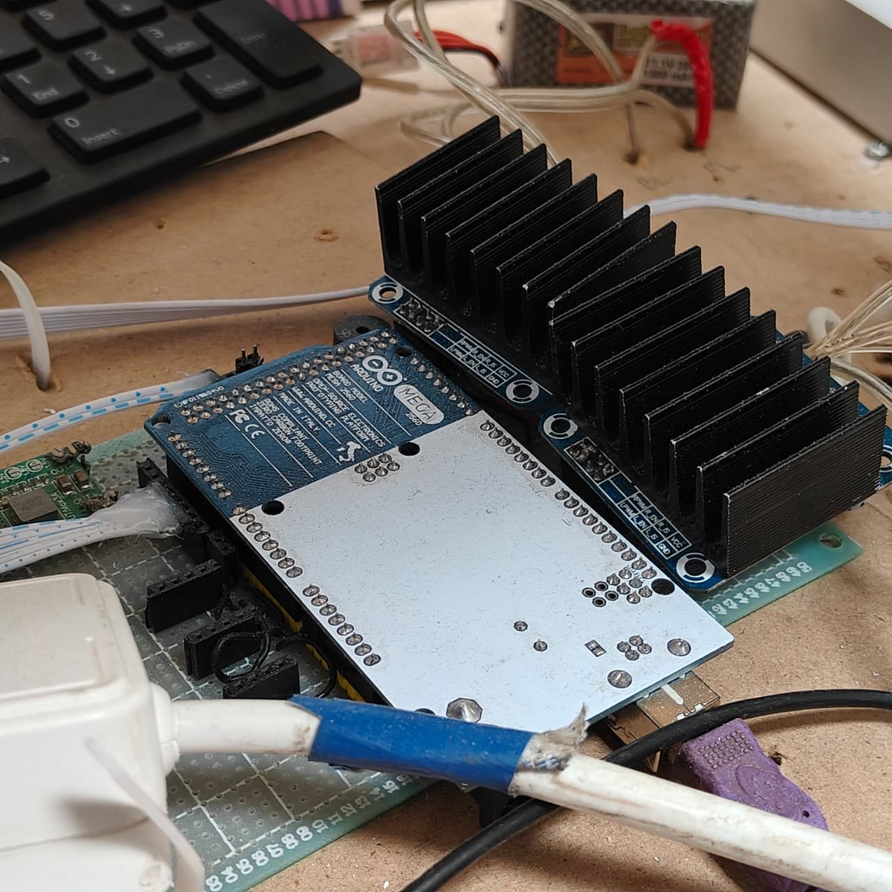
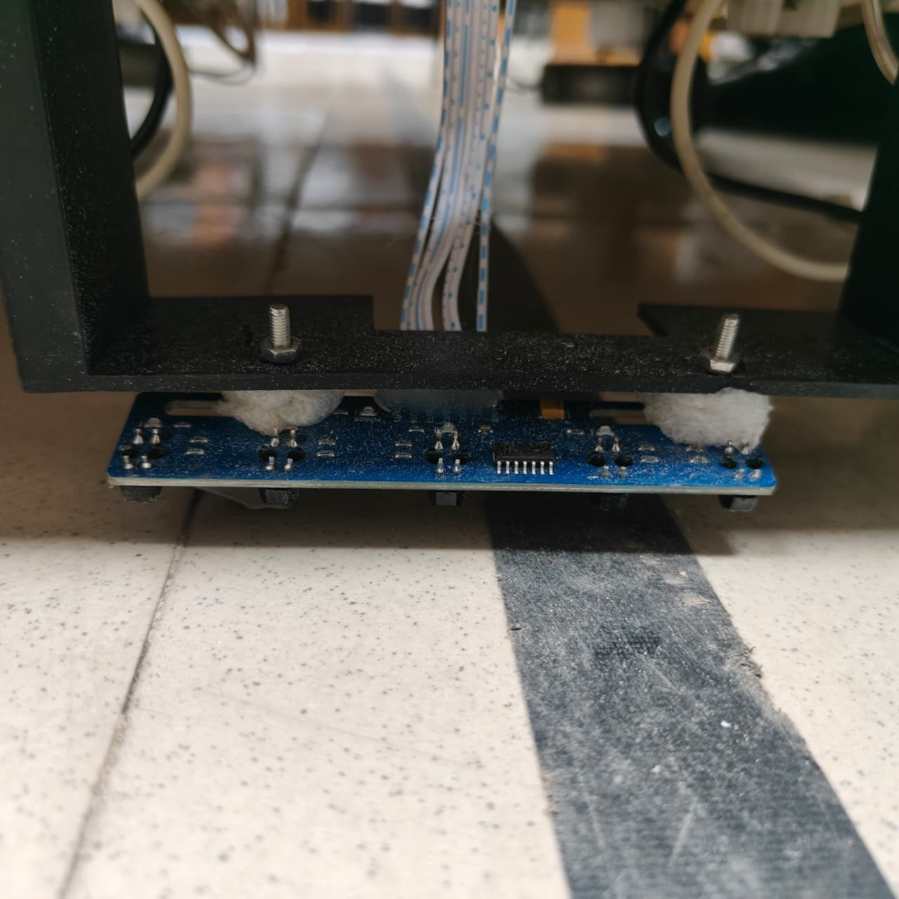
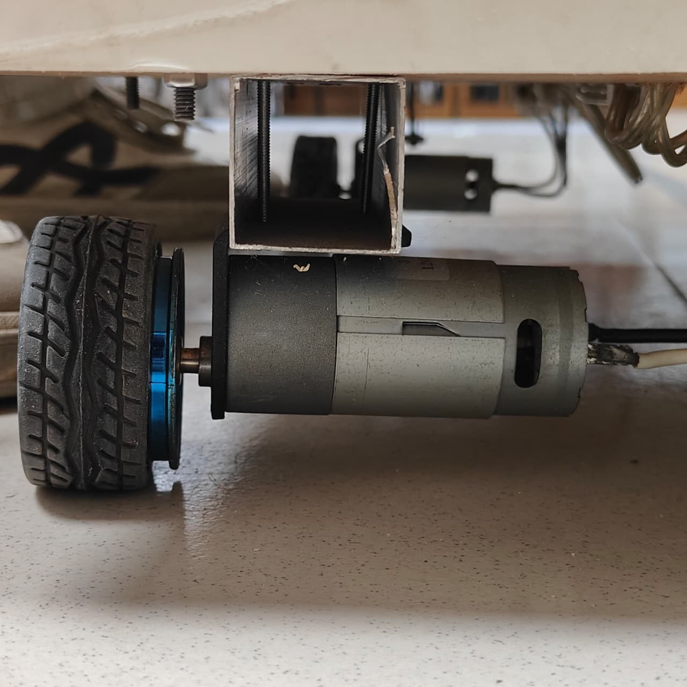
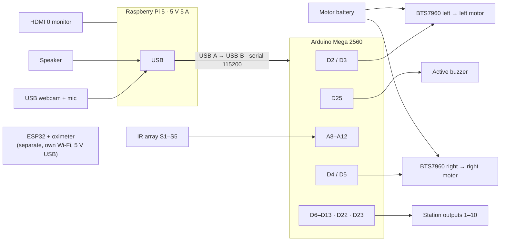

# MediCart hardware

Every pin, cable and mounting rule the software depends on. If a new body keeps these, the firmware, the Pi program and the web console work without changes.

> [!TIP]
> The printable version, with drawings, the power plan and a wiring log to fill in, is [`MediCart_Hardware_Reference.pdf`](MediCart_Hardware_Reference.pdf) (source: [`hardware_reference.html`](hardware_reference.html)).

<table>
<tr>
<td width="33%"></td>
<td width="33%"></td>
<td width="33%"></td>
</tr>
<tr>
<td align="center">Arduino Mega + 2 × BTS7960</td>
<td align="center">IR array over the black line</td>
<td align="center">Drive motor and wheel</td>
</tr>
</table>

## Wiring at a glance

## Arduino Mega 2560 pin map

| Pin | Connected to | Firmware behaviour |
|---|---|---|
| D2 | Left BTS7960, forward PWM | 0–255, left wheel forward when > 0 |
| D3 | Left BTS7960, reverse PWM | left wheel backward |
| D4 | Right BTS7960, forward PWM | right wheel forward |
| D5 | Right BTS7960, reverse PWM | right wheel backward |
| D6 – D13 | Station outputs 1 – 8 | HIGH for the station the camera confirmed (`QR:n`), one at a time |
| D22, D23 | Station outputs 9, 10 | same |
| D25 | Active buzzer | solid tone = stopped by a person / E-stop / no Pi · short beeps = line lost |
| A8 – A12 | IR sensors S1 – S5 | read as digital, **LOW = black line** |
| USB-B | Raspberry Pi | commands from the Pi + power for the Mega (Serial 0) |
| D0, D1 | **keep free** | they are the USB serial link |
| 5 V, GND | IR array, BTS logic, buzzer | logic supply and common ground |

PWM frequency: D2, D3, D5 ≈ 490 Hz; D4 ≈ 980 Hz (Arduino defaults). All other pins are unused.

## Motor drivers (BTS7960 / IBT-2) and motors

| Item | Value |
|---|---|
| **Direction rule (must)** | D2 > 0 → left wheel forward · D4 > 0 → right wheel forward. A wheel turns the wrong way? Swap that motor's two leads, not the code. |
| **Enable pins (must)** | R_EN and L_EN tied to **5 V** on both boards. The firmware never drives them. |
| Line-following speed | base 50 PWM, max 50, search 50 · steering gain 20 (max 40) · slew 300 PWM/s |
| Reverse-turn assist | only S2 → (−15, 50) · only S1 → (−50, 50) · mirrored for S4 / S5 |
| Manual speed | Serial keys 50 · Pi / web starts at 40, capped at 180 |
| Motor model, gearbox, wheel Ø, motor voltage | *fill in*; new motors or wheels mean re-testing line following |

## IR line sensor array

A 5-channel digital array (OUT1–OUT5, 5 V, GND), black line on a light floor.

| Item | Value |
|---|---|
| **Wiring (must)** | S1→A8 · S2→A9 · S3→A10 · S4→A11 · S5→A12 · VCC 5 V · GND |
| **Orientation (must)** | **S1 on the cart's left** looking forward, S5 on the right, across the line, centred, ahead of the drive wheels |
| Height | about 3–8 mm, all five equal. Trim each channel so its LED switches exactly over the line. |
| Crossing (all five on the line) | drives straight across |
| Line lost (none) | turns towards the side it last saw for 1.5 s, then stops |
| **Check** | Serial Monitor `i` → line under the middle sensor prints `S1-S5 00100`; slide the cart and the `1` moves one sensor at a time |

There's also a bench sketch, [`arduino/medicart_test`](../arduino/medicart_test/): a live IR viewer with calibration (`c`) and invert (`i`), plus manual driving and line following, for checking a new array.

## Buzzer and station outputs

- **Buzzer** must be an **active** buzzer (+ → D25, − → GND). Above ~20 mA, switch it with a transistor.
- **Stations:** marker *n* confirmed twice → the Pi sends `QR:n` → that pin goes HIGH, all others LOW. `RESET_QR` → all LOW. 5 V logic, ~20 mA max: drive lamps or relays through a transistor or a relay module.

| Station | 1 | 2 | 3 | 4 | 5 | 6 | 7 | 8 | 9 | 10 |
|---|---|---|---|---|---|---|---|---|---|---|
| Pin | D6 | D7 | D8 | D9 | D10 | D11 | D12 | D13 | D22 | D23 |

## Raspberry Pi 5

| Item | Value |
|---|---|
| **Power (must)** | 5 V **5 A** (27 W) USB-C. With less, the Pi limits USB to 600 mA total and the Mega and webcam drop off ("Arduino ✗, camera ✗"). |
| **Monitor (must)** | HDMI 0, next to the power socket |
| GPIO header | not used. Everything is USB or HDMI. |
| Cooling | active cooler + air flow (YOLO keeps the CPU busy) |
| Wi-Fi | keep the antenna area free of metal. No known Wi-Fi → hotspot `MediCart-Cart-Setup` |
| OS | Ubuntu Desktop 24.04 LTS 64-bit |

## Camera

One USB webcam is the **safety brake**, the **station reader** and the **call camera**.

| Item | Value |
|---|---|
| **Direction (must)** | forward, in the driving direction, level |
| **Field of view (must)** | nothing of the body, screen or cables in the picture |
| **Mount (must)** | rigid, not blockable. A covered camera isn't detected as a fault; YOLO just sees "no people". |
| Height | about chest height of an adult, so a person at 1 m fits head to feet |
| Mode | 1280 × 720 MJPEG, YOLOv8n-pose, confidence 0.35 |
| Zones | **STOP ≤ 1.0 m** · WARNING ≤ 2.0 m · a box over 60 % of the picture = STOP |
| Markers | ArUco `DICT_4X4_50` IDs 1–10, or QR codes; 2 scans in a 3-frame window confirm |

**New camera, lens, height or angle → calibrate again:** run `opencv_human_distance_arucoqr.py.py`, stand at a measured distance, press `C`, type your height and the distance. It writes `camera_calibration.json`, which `medicart.py` reads. Then check: stand at 1 m → the cart must stop.

## ESP32 vital sensor

| Item | Value |
|---|---|
| **Board (must)** | ESP32 Dev Module (classic ESP32, **WROOM**). Not S3; not WROVER (GPIO 16/17 = PSRAM). |
| Oximeter UART | module TX → **GPIO 16** · module RX → **GPIO 17** · 115200 · packets `0x41 0x42` + 12 bytes |
| Power | 3V3 or 5 V as the module needs · **common GND** |
| BOOT (GPIO 0) | hold 5 s while running → Wi-Fi setup |
| LED (GPIO 2) | fast = setup · slow = connecting · solid = online |
| Supply | 5 V USB, ~0.3 A |
| Placement | easy to reach for a sitting or lying patient. The sensor itself must not move. |

## Power and grounding

| Consumer | Needs |
|---|---|
| Raspberry Pi 5 | 5.1 V, 5 A |
| Arduino Mega | 5 V, ~0.2 A (USB from the Pi) |
| IR array, BTS logic, buzzer | 5 V from the Mega |
| BTS7960 motor power (B+/B−) | motor voltage, stall current |
| ESP32 + oximeter | 5 V USB, ~0.3 A |

- **Must:** a common ground between the Mega, both BTS7960 logic grounds and the IR array. Motor negative and logic ground meet at **one point**.
- **Must:** the Pi supply keeps 5 A when the motors start (dips reset the Pi or drop USB devices).
- **Recommended:** separate DC-DC converters for the Pi and the rest, a fuse on the motor battery, a main switch, and a **hardware E-stop that cuts motor power**.
- **Recommended:** route motor wires away from the IR array, USB and camera cables; twist each motor pair.

## After reassembly: the test

1. Wheels lifted. Serial Monitor: `MediCart ready`, `FW medicart 3.4`.
2. `p`, then `w` / `a` / `s` / `d`: each wheel turns the right way. Then `x`.
3. `i` over the line → `00100`; slide left and right.
4. Pi on: `medicart-status` all ✓.
5. Pi dashboard → **Manual**, hold `W` → wheels turn; let go → stop within a second.
6. **Auto** on the line, nobody in front → drives; step in at 1 m → stops (buzzer solid).
7. Unplug the Mega's USB while driving → stops within 750 ms.
8. Measure the stopping distance from full manual speed.
